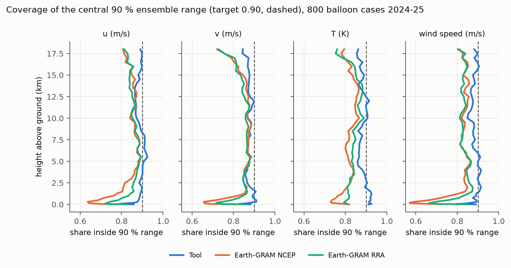
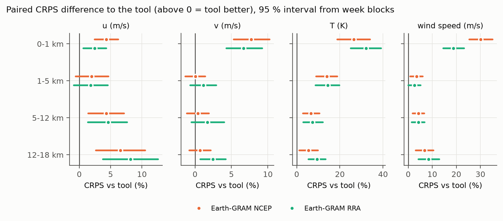
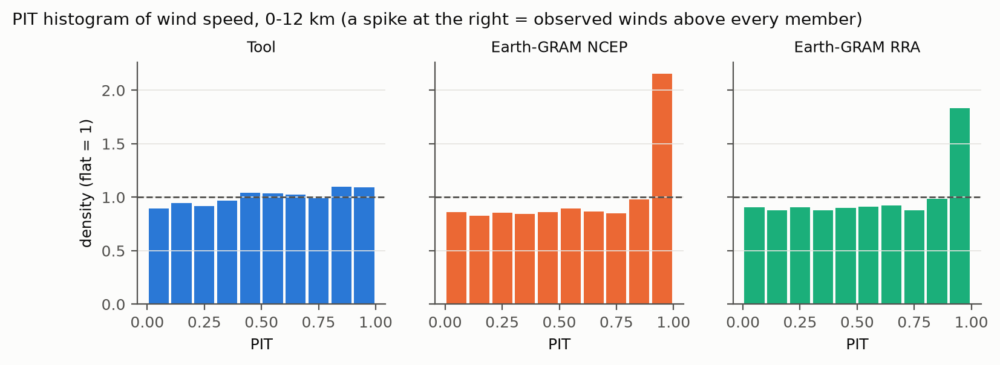
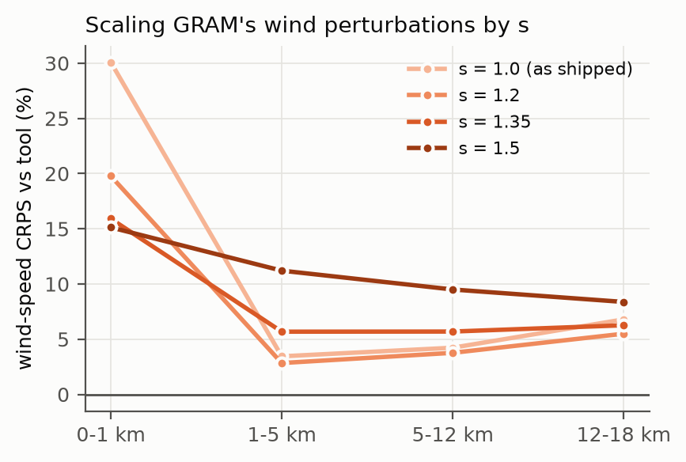

# Tempest-ARKNET vs NASA Earth-GRAM 2016: comparison against radiosondes

Status 2026-11-22. Report only: no tool code was changed. Every number below is copied from a log in `docs/results/logs/`; the log is named in each section.

## Setup

| | |
|---|---|
| Truth | IGRA radiosondes at Santa Teresa / El Paso (USM00072364, "EPZ") and Midland (USM00072265, "MAF"), 2024-25, 00 and 12 UTC |
| Cases | 800 (400 per station), the b9 kit case list `data/kit/gram_cases.csv`; 44 model heights, 10 m to 18 km above ground |
| Tool | the installed Tempest-ARKNET, climate mode, 100 members, kit seed rule (1000 x year + day of year) |
| Earth-GRAM NCEP | real Earth-GRAM 2016 v2.0 PC executable, 100 Monte Carlo profiles per case, NCEP 1997-2015 climatology at the case's month and UTC hour |
| Earth-GRAM RRA | as NCEP plus the 2006 Range Reference Atmosphere (El Paso RRA at EPZ; no RRA within 2.5 deg of MAF, so MAF is identical to NCEP) |
| Stand-ins | `gramlike`, `bank`, `gaussfull`: the kit's earlier GRAM stand-ins, kept to show how far they were from the real GRAM |
| Scores | CRPS, 90/99 % coverage, PIT, spread-skill, variogram score (VS), vertical and cross-variable correlation error, shear and Richardson-number shape; paired source-minus-tool differences with block-bootstrap 95 % intervals |

Scripts: `new_plan_kit/b9_earthgram_run.py` (runs GRAM), `b9_gram_compare.py` (overall scores), `b9_earthgram_clim.py` (climatology), `b9_earthgram_breakdown.py` (by band, season, hour, station, calibration), `b9_earthgram_scale.py` (GRAM wind-scale sensitivity), `paper/gram_block_robust.py` (block-length robustness), `paper/gram_figures.py` (figures), `b9_flight_inputs.py` + `flight_sim_trial/gram_flights.py` + `b9_flight_score.py` (flight impact).

### Caveats, read first

1. **Not a blind test.** The tool is balloon-corrected at these two stations. GRAM sees only its own global (NCEP) or El Paso RRA climatology. The result says the tool is better *where it was corrected*; it says nothing about stations it was not corrected at.
2. **Development set, reused.** 2024-25 balloons were used during tool development. No 2026 data is used anywhere here.
3. **Earlier log entry superseded.** The 2026-11-17 entry in `kit_b9_gram_compare.log` scored an older tool build. The 2026-11-22 18:18 entry regenerates the tool members from the current install and is the one used here. Tool numbers differ slightly between the two; conclusions do not.
4. **Climatology base periods differ.** GRAM NCEP is 1997-2015, RRA El Paso is 1990-95, the tool is trained 1991-2020 with trend terms. A warm 2024-25 shows up as a negative T mean error for every climatology, GRAM most.

## 1. Overall accuracy (`kit_b9_gram_compare.log`, entry 2026-11-22 18:18)

| Source | CRPS u | CRPS v | CRPS T | cov90 u / v / T | cov99 u / v / T | vertical-corr error |
|---|---|---|---|---|---|---|
| **tool** | **4.399** | **4.373** | **1.962** | 0.883 / 0.876 / 0.891 | 0.976 / 0.972 / 0.976 | 0.053 |
| Earth-GRAM NCEP | 4.595 | 4.438 | 2.245 | 0.820 / 0.825 / 0.813 | 0.929 / 0.923 / 0.920 | 0.307 |
| Earth-GRAM RRA | 4.603 | 4.484 | 2.302 | 0.839 / 0.833 / 0.834 | 0.941 / 0.931 / 0.935 | 0.295 |
| gramlike (stand-in) | 4.530 | 4.369 | 2.127 | 0.878 / 0.883 / 0.874 | 0.972 / 0.970 / 0.969 | 0.152 |

Paired GRAM minus tool, % of the tool's score, day-block 95 % interval (all favour the tool):

| | CRPS u | CRPS v | CRPS T | VS u | VS v | VS T |
|---|---|---|---|---|---|---|
| NCEP | +4.4 % | +1.5 % | +14.5 % | +5.9 % | +16.1 % | +12.1 % |
| RRA | +4.6 % | +2.5 % | +17.4 % | +7.0 % | +14.7 % | +17.9 % |

Ties: the cross-variable (u-v-T) correlation error and the co-extreme distance. The cross-variable variogram score (VSx) is a tie for NCEP and a marginal tool win for RRA.

Shape (same entry): GRAM's 0-1 km shear p99 is 0.56 of the balloons' (tool 0.70). Its 5-12 km median shear is 1.33 times too high (tool 0.89). Its 0-1 km share of layers with Ri < 1 is 0.545 against 0.738 in the balloons (tool 0.649). Its hydrostatic gap is 0.082 % (tool 0.064 %, balloons 0.026 %).

**The stand-in was too kind to GRAM.** Real GRAM's vertical-correlation error (0.307) is twice that of `gramlike` (0.152), and its coverage is about 6 points lower.

## 2. Is it significant, and robust to the bootstrap block? (`kit_b9_gram_block_robust.log`)

Weather persists over several days, so resampling single days can make the intervals too narrow. The paired test was repeated with day (527), ISO-week (105) and month (24) blocks. Both stations share a block, so EPZ and MAF on the same day are never split.

A result holds for **every** block length (interval excludes 0) for:
- **T, all bands, both GRAM variants**: NCEP +12.9 % overall (month-block interval +8.2 to +17.5 %), +26.4 % at 0-1 km.
- **Wind speed, all bands**: NCEP +30.1 % at 0-1 km, +3.4 to +6.8 % aloft.
- **u**: everywhere except 1-5 km (+2.0 %, interval spans 0).
- **v**: only at 0-1 km (+7.7 %). Aloft, v is a tie. Pooled over 0-18 km, NCEP v is +1.2 %, with a week-block interval of -0.0 to +2.3 %, so the overall v win is **not robust**. (The kit's +1.5 % for v uses all 44 heights; the 0-18 km band average weights heights slightly differently.)

## 3. Where the gap comes from (`kit_b9_earthgram_breakdown.log`)

CRPS, GRAM NCEP minus tool, by band (day-block 95 % interval):

| | 0-1 km | 1-5 km | 5-12 km | 12-18 km |
|---|---|---|---|---|
| T | +26.4 % | +14.0 % | +6.6 % | +5.4 % |
| v | +7.7 % | tie | tie | tie |
| wind speed | +30.1 % | +3.4 % | +4.2 % | +6.8 % |

- **Season**: the T gap is largest in JJA (GRAM/tool CRPS ratio 1.456 at 0-1 km).
- **Hour**: GRAM is worst at 12 UTC, the early-morning boundary layer (0-1 km wind-speed ratio 1.564, T 1.424). At 00 UTC the 0-1 km wind is nearly a tie (u 0.990, v 1.007).
- **Station**: the T gap is larger at EPZ (0-1 km ratio 1.423) than at MAF (1.146). GRAM's El Paso RRA does not close it.

**Calibration** (section 6): GRAM is too narrow near the ground.
- 0-1 km 90 % coverage: u 0.689, v 0.705, wind speed 0.657. Tool: 0.849, 0.877, 0.863.
- 0-1 km spread-skill: wind speed 0.591 (tool 0.967).
- Its T PIT mean is 0.66 at 0-1 km (target 0.5), so the observed air is warmer than GRAM's members. This is the warm 2024-25 against a 1997-2015 base.

**Wind-speed PIT** (section 7, 0-12 km pooled): GRAM NCEP puts 2.15 times the expected share above its highest member (RRA 1.83). Strong winds happen more often than GRAM allows. The tool's histogram is flat within 0.89 to 1.10.

## 4. Can GRAM be fixed by turning up its wind perturbations? (`kit_b9_earthgram_breakdown.log`)

GRAM's `ruscale` scales its wind perturbations linearly about its own mean. This was checked: a real ruscale = 1.4 run matches mean + 1.4 x (member - mean) to within 0.012 m/s. So the scale factors s = 1.2, 1.35 and 1.5 were applied exactly to the s = 1 members.

- Wind-speed CRPS against the tool at 0-1 km improves from +30.1 % (s = 1) to about +16 % (s = 1.35). It gets **worse** aloft (s = 1.5: +11 % at 1-5 km against +3.4 %).
- At s = 1.35, wind-speed coverage at 0-1 km is only 0.773. Aloft, the PIT variance falls to 0.66-0.91, meaning the ensemble is too wide there.
- One scale factor cannot fix the vertical structure: GRAM is too narrow near the ground and about right aloft. The vertical-correlation error is also untouched by scaling.

## 5. Climatology check (`kit_b9_earthgram_clim.log`)

Groups: 48 station x month x hour groups, against the 1991-2020 balloon climatology (median 834 balloons per group).

- **Spread ratio** (SD / balloon SD, target 1), 0-1 km: GRAM NCEP u 0.73, v 0.78; tool 0.97, 0.95.
- **Wind-speed q99 ratio**: GRAM 0.71-0.89 by band; tool 0.91-1.01. GRAM's tails are too short.
- **Mean bias**: GRAM is closer to the 1991-2020 balloon mean than the tool (tool T +0.76 to +1.31 K). Against 2024-25, though, GRAM's T mean error is -2.27 K at 0-1 km.
  - Read this as: the tool's trend terms move its mean toward the recent warm years, at the cost of a bias against the 30-year mean.
- **Sanity**: GRAM's Monte Carlo member SD matches its own reported SD to within 0.99-1.00, so the GRAM runs are behaving as designed.

## 6. Speed (`kit_b9_earthgram_clim.log`)

Per case (100 members x 44 heights, this machine, one process):
- tool: median 0.49 s (first call 1.7 s, which loads assets);
- Earth-GRAM: median 1.65 s.

The tool is about 3.4 times faster.

## 7. Flight impact (`kit_b9_flight_score.log`)

Sol Invictus (the flight_sim example rocket) was launched at each station for 80 cases (40 per station). Each case has 30 member flights per source plus one flight through the observed balloon profile, which is the truth. All flights are dry, with no vertical wind. The truth flights reached a median apogee of 3,604 m with 803 m of drift (p5-p95: 395-1,256 m), so these scores reflect the 0-5 km atmosphere. Sources: the tool, GRAM NCEP, and GRAM NCEP with ruscale = 1.35.

| Source | CRPS apogee (m) | CRPS drift (m) | CRPS max q (Pa) | landing energy score (m) | 90 % cov. drift | 90 % landing ellipse |
|---|---|---|---|---|---|---|
| **tool** | **22.8** | **143.7** | **505** | **225.7** | **0.80** | **0.825** |
| GRAM NCEP | 24.5 | 156.2 | 595 | 245.3 | 0.63 | 0.537 |
| GRAM NCEP ru1.35 | 25.3 | 152.6 | 598 | 237.9 | 0.75 | 0.775 |

Paired GRAM NCEP minus tool, % of the tool's CRPS, day-block 95 % interval:
- **landing energy score +8.7 % [+3.5, +14.0]**
- drift +8.7 % [+1.1, +16.2]
- north +9.3 % [+0.4, +17.9]
- max q +17.7 % [+1.3, +34.8]
- apogee +7.7 % [-4.6, +19.9] and east +6.3 % [-1.0, +14.2]: both favour the tool but are not significant.

With ru1.35, the landing energy score is still +5.4 % worse [+0.5, +10.2], and drift becomes a tie.

- **Landing dispersion.** GRAM's 90 % landing ellipse holds the real landing point only 54 % of the time; the tool's holds it 83 % of the time. For range-safety ellipses this is the result that matters most, because a GRAM-based ellipse is about half as likely as it claims to contain the landing. Scaling GRAM's winds by 1.35 brings this to 78 %.
- **Max q.** GRAM's mean max q is 390 Pa too high (tool: +98 Pa). This follows from its cold bias: colder air is denser.
- **By station.** The tool has the lower drift CRPS at both stations. Its landing coverage is 0.95 at MAF and 0.70 at EPZ, so the tool is also a little too narrow at EPZ.
- **Caveats.** With 80 cases the intervals are wide. Max-Mach CRPS is below 0.005 for every source. Flight-time spread-skill is 2-3 for every source because flight time barely varies, so these two outputs carry no signal.

## Bottom line

At these two stations, on the 2024-25 development balloons, the tool is significantly better than real Earth-GRAM 2016:
- for temperature at every height (about 13-15 % lower CRPS overall);
- for wind speed and u at most heights;
- for v near the ground.

The result holds with week and month bootstrap blocks. It is also better calibrated (90 % coverage 0.88-0.89 against GRAM's 0.81-0.84), has the right vertical correlation (error 0.053 against 0.307), and is 3.4 times faster.

It carries through to the rocket. In Sol Invictus flights, the landing-point energy score is 8.7 % better [+3.5, +14.0]. The tool's 90 % landing ellipse holds the real landing point 83 % of the time; GRAM's holds it 54 %.

GRAM's main weaknesses are a boundary layer that is too narrow, wind-speed tails that are too short, and a vertical correlation that is too weak. Scaling GRAM's wind perturbations does not fix them.

The tool's v advantage aloft is a tie. The whole comparison is at stations where the tool was balloon-corrected. A blind-station comparison is the obvious next test.
